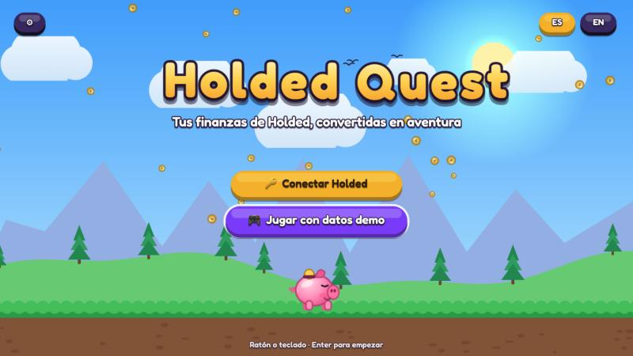
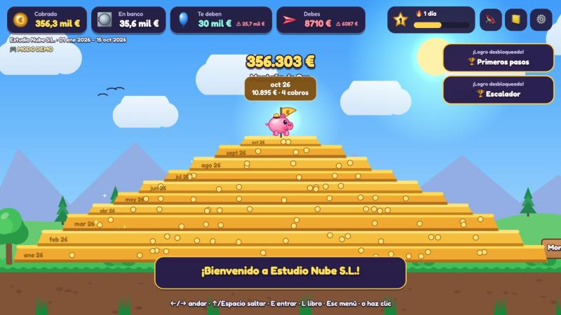
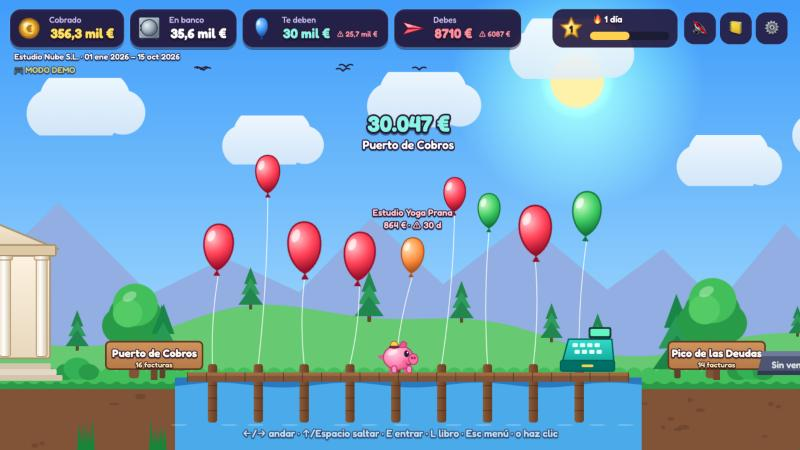
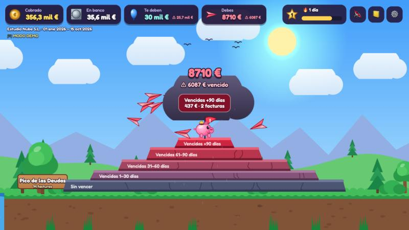
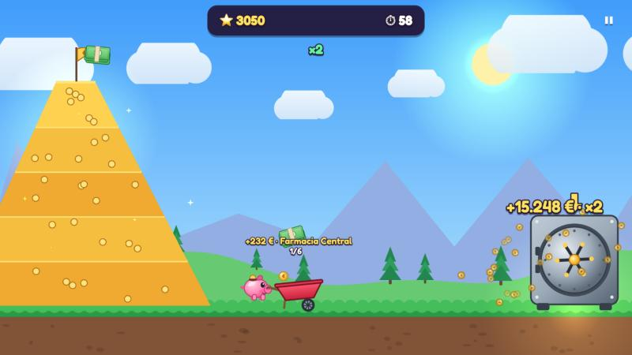
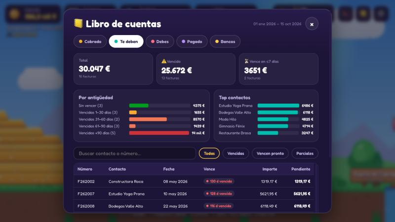

# Holded Quest 🐷💰

Tus finanzas de Holded convertidas en un mundo de videojuego. Pip, un cerdito-hucha, recorre un valle donde:

| Zona | Qué representa (Holded API v2) | Minijuego |
|---|---|---|
| **Montaña de Oro** | Cobros del periodo (`/v2/payments` de facturas de venta). Cada estrato es un mes y se puede escalar. | **Carrera a la Caja Fuerte**: atrapa el dinero que cae y llévalo en carretilla a la caja. Combos ×2…×5, cajas de IVA (−21 %), relojes e imanes. |
| **La Caja Fuerte** | Saldos de tesorería (`/v2/treasury/accounts`) y movimientos bancarios (`/v2/treasury/accounts/{id}/bank-movements`). | **Río de Tesorería**: navega tu saldo real día a día; el nivel del agua es tu dinero en el banco. Salta las rocas (grandes pagos) y coge las bolsas (grandes cobros). También el **Salón de Trofeos**. |
| **Puerto de Cobros** | Facturas de venta pendientes (`/v2/invoices?status=outstanding`). Cada globo es un cliente que te debe. | **Caza Globos**: engancha los globos antes de que se escapen. Al final, la lista de clientes a los que reclamar. |
| **Pico de las Deudas** | Facturas de compra pendientes (`/v2/purchases?status=outstanding`), en estratos por antigüedad (sin vencer → +90 días). | **Esquiva Deudas**: tus facturas son aviones de papel; las vencidas van más rápido y te persiguen. Los casi‑choques suman combo; las monedas de pago “pagan” el avión más cercano. **Jefe del IVA**: el Monstruo del IVA del trimestre (IVA de tus facturas de venta y compra). Tus deducciones caen como recibos dorados que cargan el supergolpe; al final verás la estimación del modelo 303 y su plazo. |

Además: **visita guiada** la primera vez y flechas sobre las zonas que aún no has visitado, **aviso del plazo del IVA** cuando faltan 10 días o menos, **Libro de cuentas** (tablas, filtros, gráficos por mes y por antigüedad), animación **“Desde tu última visita”** con lo que ha cambiado, XP y niveles, racha diaria, 16 logros, música chiptune y efectos procedurales, español/inglés, ratón, teclado y **controles táctiles** en móvil (en horizontal).

Todo el arte y el sonido se generan por código: no hay ficheros de imagen ni audio.

| | |
|---|---|
|  |  |
|  |  |
|  |  |

El cielo sigue la hora real (día, atardecer, noche). Para previsualizar otra hora: `http://localhost:5173/?hour=12`.

## Arrancar

Requiere Node 22.12 o superior.

```bash
npm install
```

```bash
npm run dev
```

Abre http://localhost:5173 y elige **Jugar con datos demo** o **Conectar Holded**. La música empieza apagada: actívala con el icono de la nota (en la pantalla de inicio o arriba a la derecha en el juego) o con la tecla M.

### Controles

| | Mundo | Minijuegos |
|---|---|---|
| Ratón / táctil | Clic en el suelo para andar (salta escalones solo), clic en carteles/edificios para entrar | Carretilla sigue al ratón · el cerdito vuela hacia el ratón y clic = esquive rápido · clic en un globo = gancho |
| Teclado | ←/→ o A/D andar · ↑/W/Espacio saltar · E/Enter entrar · L libro · M música · Esc menú | Flechas/WASD · Espacio = esquive / gancho · Esc pausa |

## Conectar tu cuenta de Holded

1. En Holded: **Configuración → API → Crear clave** (API v2).
2. Dale permisos **solo de lectura** para facturas de venta, compras, pagos y tesorería. Si falta alguno, esa zona aparece con un candado y el resto funciona.
3. En el juego: **Ajustes → Clave API de Holded → Guardar y cargar datos**.

Detalles importantes:

- **La clave nunca se guarda en ningún servidor.** Por defecto vive en `sessionStorage` (se borra al cerrar la pestaña); marca “Recordar en este dispositivo” para guardarla en `localStorage`.
- La API de Holded no permite llamadas desde el navegador (sin CORS), así que la app incluye un **proxy de solo lectura** (`server/holdedProxy.ts`): solo acepta `GET`, solo a rutas permitidas, y solo reenvía la cabecera `Authorization`.
- **Cuota de Holded**: hay planes con solo 500 llamadas al mes. Una actualización completa son ~4–8 llamadas. El juego abre siempre desde caché (IndexedDB) y solo vuelve a descargar si los datos tienen más de 12 h o si pulsas **Actualizar datos ahora**. Las llamadas restantes se muestran en Ajustes.
- **Río y Jefe del IVA**: sus datos (movimientos bancarios y facturas del trimestre) solo se descargan al entrar en ellos y se guardan 24 h. Si la clave no puede leer movimientos, el río se estima a partir de cobros y pagos.
- **IVA**: el trimestre mostrado es el que acaba de cerrar mientras está abierto su plazo (1–20 de abril, julio y octubre; hasta el 30 de enero), y si no, el trimestre en curso. Es una **estimación orientativa** (repercutido − soportado de tus facturas, sin rectificativas ni regímenes especiales): confírmala con tu gestoría.
- Holded responde `403` tanto a una clave inválida como a un permiso que falta; si todas las zonas dan `403`, el juego te dice que revises la clave.
- La API v1 (cabecera `key`) deja de funcionar el 1 de julio de 2027; este proyecto usa la v2 (`Authorization: Bearer`).

## Desplegar (opcional)

El proyecto es un Vite estático más una función de Vercel (`api/holded.ts`) que reutiliza el mismo proxy.

```bash
npx vercel
```

Recomendado: activa **Deployment Protection** en Vercel para que la URL no sea un proxy público (sin clave no hace nada, pero mejor cerrarlo).

## Scripts

| Comando | Qué hace |
|---|---|
| `npm run dev` | Servidor de desarrollo con el proxy en `/api/holded` |
| `npm test` | Tests (normalización, paginación, proxy, diff, progreso) |
| `npm run typecheck` | Comprobación de tipos |
| `npm run build` | Typecheck + build de producción en `dist/` |
| `npm run preview` | Sirve `dist/` con el proxy |

## Estructura

```
server/holdedProxy.ts   proxy GET-only con lista blanca (Vite dev/preview y Vercel)
api/holded.ts           función de Vercel
src/data/               cliente Holded v2, normalización, agregados, diff, río (cash), IVA (vat), demo, caché
src/game/scenes/        Boot, Title, World, Hud, VaultRush, DebtDodge, BalloonCatch, CashRiver, BossVat, Results, Pause
src/game/art/           todo el arte, dibujado con Canvas 2D
src/audio/              efectos (ZzFX) y secuenciador chiptune (WebAudio)
src/ui/                 Libro de cuentas, Ajustes y Trofeos (DOM accesible)
tests/                  vitest + fixtures con la forma de la API v2
```

## Ideas para seguir

- Ranking entre socios con una base de datos compartida.
- Mandos de consola (Gamepad API).
- Previsión: el río continúa hacia el futuro con los cobros y pagos pendientes por vencimiento.
